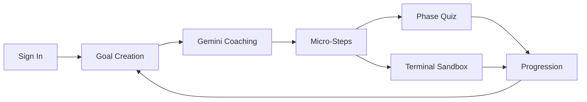

# Quantum Leaps

<p align="center">
  <b>Turn ambitious goals into microscopic, executable progress.</b>
</p>

<p align="center">
  React 19 · Vite · TypeScript · Gemini · Firebase · Terminal Sandbox
</p>

<p align="center">
  <span>Goal strategy</span> · <span>Progress tracking</span> · <span>Phase quizzes</span> · <span>Hands-on terminal practice</span>
</p>

---

## Overview

Quantum Leaps is a standalone goal-decomposition app built for people who want structure without noise.
It takes a large objective, interrogates the constraints, generates micro-steps, validates progress through quizzes, and offers a terminal sandbox for selected steps that benefit from real practice.

The experience is deliberately focused: fast to start, clear to read, and designed to make momentum visible.

## What It Does

- Converts broad goals into 15-minute-to-30-minute actions
- Tracks phase-based progress across long-running plans
- Uses Gemini to generate coaching, step breakdowns, and quizzes
- Persists user goals and state with Firebase Auth and Firestore
- Opens a terminal sandbox for step-specific practice when it adds value

## Highlights

| Area | Why It Matters |
| --- | --- |
| Goal decomposition | Keeps ambitious work small enough to start now |
| Progress visibility | Makes next actions obvious instead of vague |
| Terminal practice | Turns selected steps into interactive execution |
| Structured evaluation | Reinforces learning with phase quizzes |
| Firebase persistence | Keeps user data tied to an account |

## Terminal Practice

The terminal sandbox is part of the product, not an afterthought.
It gives selected steps a live execution space with editor, console, verification, and practice-oriented feedback.

Use it when a step is better learned by doing than by reading.

## Local Setup

1. Install dependencies.

  ```bash
  npm install
  ```

2. Create your local environment file.

  ```bash
  cp .env.example .env.local
  ```

3. Add your Gemini API key.

  ```env
  GEMINI_API_KEY=your_key_here
  ```

4. Make sure Firebase is configured.

  The app loads project settings from [firebase-applet-config.json](firebase-applet-config.json). Point it at a Firebase project with Auth and Firestore enabled, and keep the default Firestore database enabled.

5. Start the app.

  ```bash
  npm run dev
  ```

6. Open the app in your browser at http://localhost:3000.

## Environment

The repository includes [`.env.example`](.env.example) as the source of truth for runtime variables.

- `GEMINI_API_KEY` is required for Gemini calls in [src/lib/gemini.ts](src/lib/gemini.ts)
- Firebase project settings come from [firebase-applet-config.json](firebase-applet-config.json)
- Firestore uses the default database configured in Firebase

## Scripts

| Script | Purpose |
| --- | --- |
| `npm run dev` | Start local development on port 3000 |
| `npm run build` | Build production assets into `dist` |
| `npm run preview` | Preview the production build locally |
| `npm run clean` | Remove `dist` |
| `npm run lint` | Run TypeScript checks with no emit |

## System Flow



## Key Files

- [src/App.tsx](src/App.tsx) contains the landing page, auth flow, dashboard, and goal detail views
- [src/components/TerminalSandbox.tsx](src/components/TerminalSandbox.tsx) powers the interactive practice environment
- [src/lib/gemini.ts](src/lib/gemini.ts) contains the Gemini prompts and structured generation helpers
- [src/lib/firebase.ts](src/lib/firebase.ts) initializes Auth and Firestore and centralizes error diagnostics
- [firestore.rules](firestore.rules) defines the Firestore security rules

## Stack

- React 19
- Vite
- TypeScript
- Motion
- Firebase Auth + Firestore
- Google Gemini API
- Tailwind CSS v4

## Development Notes

- Confirm `GEMINI_API_KEY` is set before starting the app
- Verify Firebase Auth and Firestore are enabled for the target project
- Use `npm run lint` before shipping changes
- Use `npm run build` to confirm production bundling succeeds
- Keep `.env.local` out of source control
- Use `npm run preview` before deployment

## Design Intent

This project is meant to feel precise, not generic.
The visual language leans on contrast, spacing, and measured motion so the app feels like a serious tool instead of a demo shell.
